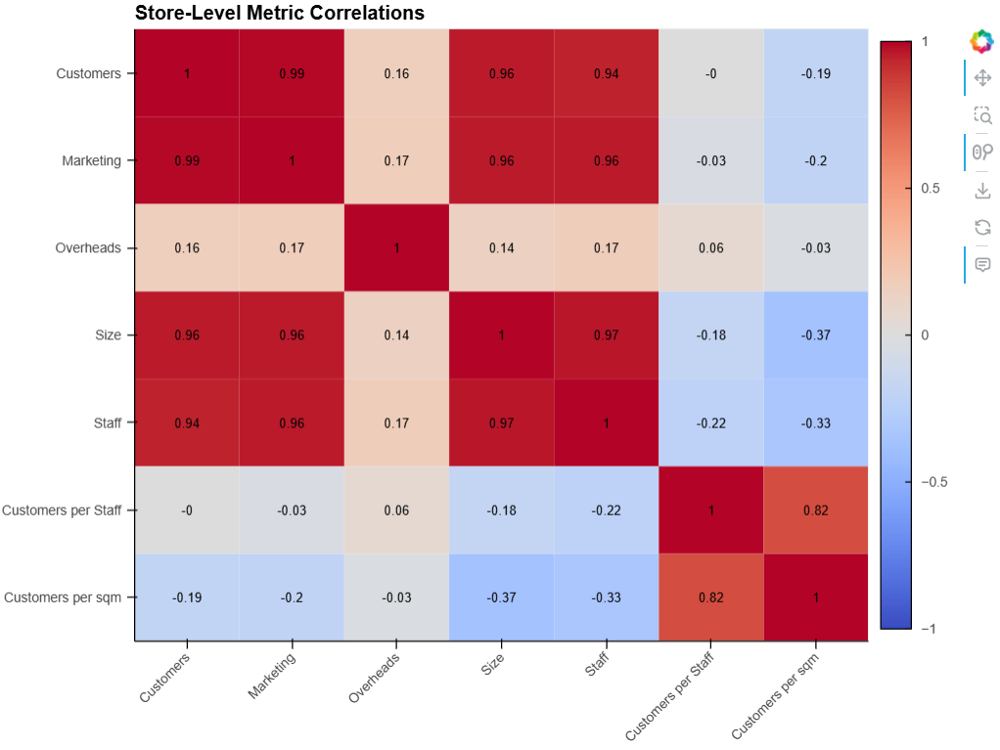

# ChrisCo Store Analytics

Retail customer behaviour and store-performance analysis using Python and eight complementary visualisations. MSc Data Science (FinTech) coursework, University of Greenwich.

## Business question

How do customer volumes differ across stores, and how do store size, staffing and marketing spend relate to those differences?

## What I did

- Combined five supplied datasets covering daily customer counts, marketing, overheads, floor space and staffing.
- Built an eight-chart narrative: segmented customer totals, distributions, daily trends, a high-volume-store comparison, a correlation heatmap, autocorrelation, resource-efficiency comparisons and a radar chart.
- Used Pandas and NumPy for preparation, Matplotlib and Seaborn for plotting, and hvPlot/HoloViews for interactive views.

## Findings

The project found correlations of approximately 0.94 or higher between customer volume and store size, staffing and marketing spend. Comparing customers per staff member and per square metre also highlighted trade-offs between absolute volume and resource efficiency.

These are associations within the coursework dataset. They do not establish that increasing marketing or staffing would cause a particular increase in customers.

## Explore the work

- [Portfolio report](portfolio-report.pdf): the written analysis and all eight visualisations.
- [Original notebook](COMP1800_DATA_VISUALISATION.ipynb).
- CSV inputs: `StoreDailyCustomers.csv`, `StoreMarketing.csv`, `StoreOverheads.csv`, `StoreSize.csv` and `StoreStaff.csv`.

## Run or inspect

The original submitted notebook and saved outputs remain available above. For local use, [analysis-local.ipynb](analysis-local.ipynb) loads the CSVs from the repository root and has cleared outputs.

1. Download or clone the complete repository.
2. Create a separate Python 3.11 environment.
3. From the repository root, run `python -m pip install -r requirements.txt`, then `python -m jupyter lab`.
4. Open `analysis-local.ipynb` with that environment's Python kernel and run cells in order.

The portable copy changes only input paths and inline installation cells. Model settings and analytical methods are preserved. Code cells passed syntax checks, and the notebook source was matched to the submitted GitHub version before adaptation. A fresh end-to-end analysis and clean-environment dependency installation have not been verified. Library changes, training time and original analytical limitations can affect reproduction.

## Context

Academic analysis by Tejesh Ramesh Bawa. The preview is a figure extracted from the project report. The portfolio PDF omits the student identifier from its cover.
